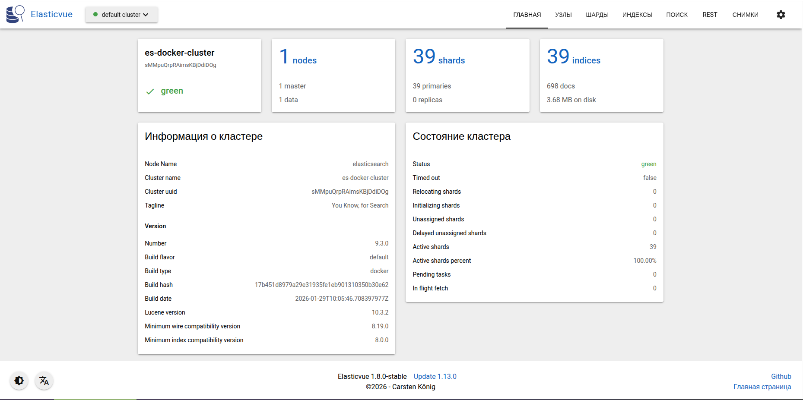

# Elasticsearch image

## Настройка авторизации

### Генерирование временных паролей для авторизации Kibana в Elasticsearch

Пароли генерируются для переменных окружения

- ELASTICSEARCH_USERNAME=kibana_system
- ELASTICSEARCH_PASSWORD=

Для того что бы сгенерировать в Elasticsearch временные пароли нужно выполнить следующие команды

```bash
docker compose up -d elasticsearch
docker exec -it elasticsearch bash
```

далее внутри контейнера выполнить

```bash
bin/elasticsearch-setup-passwords auto
```

будет сгенерирован список паролей для определённого набора пользователей. Список паролей аналогичен списку в файле _tmp_elasticsearch_credentials_. Для просмотра сгенерированных пароле в docker elasticsearch, выполняем:

```bash
docker inspect <elasticsearch_container_id> | grep -i password
```

Так же более подробную информацию можно получить по ссылке https://www.elastic.co/docs/deploy-manage/security/set-up-minimal-security

### Настройка Elasticvue

Elasticvue представляет собой минималистичный веб интерфейс для управления кластерами Elasticsearch. Пример ниже


Добавить в настройку переменных окружения Elasticsearch следующие параметры:

- http.cors.enabled=true
- http.cors.allow-origin=http://localhost:8484
- http.cors.allow-headers=X-Requested-With,Content-Type,Content-Length,Authorization
- http.cors.allow-credentials=true

### Настройка снапшотов для создания бекапов в MinIO

Перед запуском контейнеров docker нужно создать публичный ключ и сертификат

```bash
./gencerts.sh
```

Для начала надо настроить Elasticsearch-источника. Добавляем учетные данные MinIO в keystore. Elasticsearch использует защищенный keystore для хранения чувствительных данных. Выполняем следующие команды:

```bash
docker exec -it <source_container_id> bash
# Добавьте Access Key и Secret Key
bin/elasticsearch-keystore add s3.client.default.access_key
bin/elasticsearch-keystore add s3.client.default.secret_key
# Здесь default — это дефолтное имя клиента, которое вы будете использовать при регистрации репозитория
```

после добавления access и secret нужно сделать:

```bash
docker compose restart <source_container_id>
```

что бы просмотреть список существующих учетных данных выполняем:

```bash
bin/elasticsearch-keystore list
```

То есть если в настройках MinIO есть MINIO_ROOT_USER=minioadmin, то это же имя нужно использовать в строке s3.client.<имя клиента>.access_key и s3.client.<имя клиента>.secret_key. По терминологии MinIO access_key - username, secret_key - password.

Далее нужно выполнить:

```bash
curl -u elastic:<пароль> -X PUT 'http://localhost:9200/_snapshot/my-minio-snapshot' -H 'Content-type: application/json' -d '{
  "type": "s3",
  "settings": {
    "bucket": "my-backup",
    "client": "default",
    "endpoint": "https://minio:9000",
    "protocol": "https",
    "path_style_access": true,
    "region": "us-east-1",
    "readonly": false,
    "disable_chunked_encoding": true
  }
}'
#    "endpoint": "https://192.168.9.53:9900",
```

Должен быть получен ответ:

```json
{ "acknowledged": true }
```

Если получаем ощибку типа "repository_verification_exception", то проблеммы с авторизационными данными (неверный логин или пароль) или что более вероятно публичный сертификат не был добавлен в хранилище сертификатов elasticsearch.

Создаем снапшот всех индексов и глобального состояния кластера:

```bash
curl -u elastic:<пароль> -X PUT 'http://localhost:9200/_snapshot/my-minio-snapshot/snapshot_1?wait_for_completion=true'
```

параметр **wait_for_completion=true** позволяет дождатся завершения выполнения задачи.

Проверяем наличие снапшота:

```bash
curl -u elastic:<пароль> -X POST "http://localhost:9200/_snapshot/my-minio-snapshot/_verify?pretty"
```

Посмотрим все имеющиеся снапшоты:

```bash
curl -u elastic:<пароль> -X GET "http://localhost:9200/_snapshot/my-minio-snapshot/_all?pretty"
```

Так можно посмотреть информацию о конкретном индексе:

```bash
curl -u elastic:<пароль> -X GET "http://localhost:9200/testtt.module_placeholderdb_alert_rcmnvs_2026_7?pretty"
```

Смотрим количество документов в индексе:

```bash
curl -u elastic:<пароль> -X GET "http://localhost:9200/logs.placeholder_doc-base-db_july_2026/_count?pretty"
```

Проверка данных. Ищем первые 10 документов в индексе:

```bash
curl -u elastic:<пароль> -X GET "http://localhost:9200/testtt.module_placeholderdb_alert_rcmnvs_2026_7/_search?pretty" \
  -H "Content-Type: application/json" \
  -d '{
    "query": {
      "match_all": {}
    },
    "size": 10
  }'
```

Посмотреть все существующие индексы:

```bash
curl -u elastic:<пароль> -X GET "http://localhost:9211/_cat/indices?v&pretty"
```

На новом Elasticsearch, на который выполняется миграция данных со старого нужно зарегистрировать репозиторий MInIO:

```bash
curl -u elastic:<пароль> -X PUT 'http://localhost:9211/_snapshot/my-minio-snapshot' -H 'Content-type: application/json' -d '{
  "type": "s3",
  "settings": {
    "bucket": "my-backup",
    "client": "default",
    "endpoint": "https://minio:9000",
    "protocol": "https",
    "path_style_access": true,
    "region": "us-east-1",
    "readonly": false,
    "disable_chunked_encoding": true
  }
}'
#  "endpoint": "https://192.168.9.53:9900",

curl -u elastic:<пароль> -X PUT 'http://localhost:9211/_snapshot/my-minio-snapshot' -H 'Content-type: application/json' -d '{
  "type": "s3",
  "settings": {
    "bucket": "my-backup",
    "client": "default",
    "endpoint": "https://192.168.9.53:9900",
    "protocol": "https",
    "path_style_access": true,
    "region": "us-east-1",
    "readonly": false,
    "disable_chunked_encoding": true
  }
}'
```

Можно удалить все существующие индексы или удалить только пользовательские индексы:

```bash
curl -u elastic:<пароль> -X DELETE "http://localhost:9211/*"

# или что бы удалить всё выполнить
curl -s -u elastic:<пароль> -X GET "http://localhost:9211/_cat/indices"| awk '{print $3}'| while read -r index; do
  if [ -z "$index" ] || [[ "$index" == \#* ]]; then
    continue
  fi

  curl -u elastic:<пароль> -X DELETE "http://localhost:9211/$index"
done
```

удалять системные индексы не рекомендуется.

Востанавливаем снапшот всех индексов, это предпочтительно делать после удаления всех индексов:

```bash
curl -u elastic:<пароль> -X POST "http://localhost:9211/_snapshot/my-minio-snapshot/snapshot_1/_restore?pretty" \
  -H "Content-Type: application/json" \
  -d '{
    "indices": "*",
    "ignore_unavailable": true,
    "include_global_state": false
  }'
```

Востанавливаем снапшот индексов ИСКЛЮЧАЯ все системные индексы:

```bash
curl -u elastic:<пароль> -X POST "http://localhost:9211/_snapshot/my-minio-snapshot/snapshot_1/_restore?&pretty&wait_for_completion=true" \
  -H "Content-Type: application/json" \
  -d '{
    "indices": "+*,-.*,-ilm-history-*,-watcher-history-*,-security-*,-kibana-*,-elastic-*,-.apm-*,-.monitoring-*,-.ml-*,-.transform-*,-.slm-history-*,-.async-search-*,-.kibana-event-log-*,-.tasks-*,-.management-*",
    "ignore_unavailable": true,
    "include_global_state": false
  }'
```

инспекция востановленных индексов:

```bash
curl -u elastic:<пароль> -X GET "http://localhost:9211/_cluster/allocation/explain?pretty" \
  -H "Content-Type: application/json" \
  -d '{
    "index": "testtt.module_placeholderdb_alert_rcmnvs_2026_7",
    "shard": 0,
    "primary": true
  }'
```

где, "+\*" - добавить все индексы,
"-.\*" - исключить индексы начинающиеся на ".".

Востанавливаем, с переименованием, снапшот всех индексов и глобального состояния кластера:

```bash
curl -u elastic:<пароль> -X POST "http://localhost:9211/_snapshot/my-minio-snapshot/snapshot_1/_restore?pretty" \
  -H "Content-Type: application/json" \
  -d '{
    "indices": "*",
    "ignore_unavailable": true,
    "include_global_state": false,
    "include_aliases": true
  }'
```

### Настройка снапшотов для создания бекапов в NFS

Нужно добавить параметр _path.repo_ в переменные окружения

```yml
environment:
  - path.repo=/usr/share/elasticsearch/snapshots
```

после перезапуска контейнеров docker регестрируем путь для бэкапов:

```bash
curl -u elastic:<пароль> -X PUT 'http://localhost:9200/_snapshot/my-snapshot' -H 'Content-type: application/json' -d '{
  "type": "fs",
  "settings": {
    "location": "/usr/share/elasticsearch/snapshots/my_repo_location"
  }
}'
```

и создаем снапшот всех индексов и глобального состояния кластера:

```bash
curl -u elastic:<пароль> -X PUT 'http://localhost:9200/_snapshot/my-snapshot/snapshot_1?wait_for_completion=true'
```

регестрируем путь для бэкапов на сервере elasticsearch, куда будут востанавливатся снапшоты:

```bash
curl -u elastic:BNt7mHEecOhlS3982PtM -X PUT 'http://localhost:9211/_snapshot/my-snapshot' -H 'Content-type: application/json' -d '{
  "type": "fs",
  "settings": {
    "location": "/usr/share/elasticsearch/snapshots/my_repo_location"
  }
}'
```

Востанавливаем снапшот индексов ИСКЛЮЧАЯ все системные индексы:

```bash
curl -u elastic:BNt7mHEecOhlS3982PtM -X POST "http://localhost:9211/_snapshot/my-snapshot/snapshot_1/_restore?&pretty&wait_for_completion=true" \
  -H "Content-Type: application/json" \
  -d '{
    "indices": "+*,-.*,-ilm-history-*,-watcher-history-*,-security-*,-kibana-*,-elastic-*,-.apm-*,-.monitoring-*,-.ml-*,-.transform-*,-.slm-history-*,-.async-search-*,-.kibana-event-log-*,-.tasks-*,-.management-*",
    "ignore_unavailable": true,
    "include_global_state": false
  }'
```

# --------------------------------------------- Временные тестовые учетные данные ---------------------------------------------

## Для elasticsearch_source

Changed password for user apm_system
PASSWORD apm_system = 35ogw5Psc8jc5uQkofTo

Changed password for user kibana_system
PASSWORD kibana_system = YxdwprQ6arenV3Qaw0Oo

Changed password for user kibana
PASSWORD kibana = YxdwprQ6arenV3Qaw0Oo

Changed password for user logstash_system
PASSWORD logstash_system = y17jgerbcH1T4Jhjiacd

Changed password for user beats_system
PASSWORD beats_system = a1HzOGfGdb3eR1BJdbza

Changed password for user remote_monitoring_user
PASSWORD remote_monitoring_user = u7XEt7vNA5e8tfzq9zp3

Changed password for user elastic
PASSWORD elastic = IS75wLKvUOTWho3Jud8T

# Для elasticsearch_recipient

Changed password for user apm_system
PASSWORD apm_system = D1V9BV5qQjJZGcWZAEQR

Changed password for user kibana_system
PASSWORD kibana_system = zEsjVmfGnwjRAj7bfe0M

Changed password for user kibana
PASSWORD kibana = zEsjVmfGnwjRAj7bfe0M

Changed password for user logstash_system
PASSWORD logstash_system = 3qiGqJTqdNT7yobArejZ

Changed password for user beats_system
PASSWORD beats_system = jCDzSGeUgcKt8Riol3sT

Changed password for user remote_monitoring_user
PASSWORD remote_monitoring_user = p8L4Jz7wefEDI6rVds9p

Changed password for user elastic
PASSWORD elastic = BNt7mHEecOhlS3982PtM

### Примеры некоторых запросов

Просто посмотреть список индексов

```bash
GET module_placeholderdb_bizone_alerts.test_2026_10/_search?from=0&size=50
```

Поиск индекса по одному из его параметров, в данном случае по UUID

```bash
GET module_placeholderdb_bizone_alerts.test_2026_10/_search
{
  "query": {
    "bool": {
      "must": [
        {"match": {"uuid":"92b0c109-e7b7-43c7-b2dc-8aeada796a0b"}}
      ]
    }
  }
}
```

Поиск индексов по такому параметру как пустое поле affected_log_sources

```bash
GET module_placeholderdb_bizone_alerts.test_2026_10/_search
{
  "query": {
    "exists": {
      "field": "affected_log_sources"
    }
  }
}
```

Просто посмотреть список индексов

```bash
GET module_placeholderdb_bizone_incidents.test_2026_11/_search?from=0&size=50
```

Поиск индекса по одному из его параметров, в данном случае по полям _key_ и _@special\*uuid_. При этом в этих примерах
есть существенное различие.

- В первом примере поиск осуществляется по дубликату поля _key_ полю _key.keyword_ который **не разбивается на токены** и сохраняет строку в точности как есть. Когда Elasticsearch индексировал документ например со значение "INC-2065" в поле _key_, его стандартный анализатор привел его к нижнему регистру и разбил по не-алфавитным символам (в данном случае по дефису). В поисковый индекс попали токены: ["inc", "2065"]. Так работает полнотекстовый поиск в этой СУБД.
  Кроме того в запросе была использована конструкция _term_ которая **ищет точное совпадение** в отличии от конструкции _match_.

- Во втором примере использовался полнотекстовый поиск, соответственно значение поля _@special\*uuid_ разбивается по не-алфавитные символы и ищется не полное совпадение, а вхождение каждого из них.

```bash
GET module_placeholderdb_bizone_incidents.test_2026_11/_search
{
  "query": {
    "term": {
      "key.keyword": "INC-2065"
    }
  }
}
GET module_placeholderdb_bizone_incidents.test_2026_11/_search
{
  "query": {
    "bool": {
      "must": [
        {"match": {"@special_uuid":"dcf51262-0462-4fdc-8691-dff006fa110a"}}
      ]
    }
  }
}
```

Поиск индексов по такому параметру как пустое поле affected_log_sources

```bash
GET module_placeholderdb_bizone_incidents.test_2026_11/_search
{
  "query": {
    "exists": {
      "field": "affected_log_sources"
    }
  }
}
```

Удаление документов в индексе. При удалении документов методом POST надо руководствоватся тем же принципом что и по поиску документов, то есть использовать поле _\*.keyword_ и конструкцию _term_ в запросе.

```bash
DELETE module_placeholderdb_bizone_incidents.test_2026_11/_doc/yhGIh6EBcfH0hhBlYO39
POST module_placeholderdb_bizone_incidents.test_2026_11/_delete_by_query
{
  "query": {
    "term": {
      "key.keyword": "INC-2065"
    }
  }
}
```

Обновление документа в части информации о сенсорах

```bash
POST module_placeholderdb_bizone_incidents.test_2026_11/_update/2xGIh6EBcfH0hhBlde3x
{
  "doc": {
    "@sensor_additional_information": {
		  "inn":         "7703602065",
		  "host_id":      "1234",
      "geo_code":     "RU",
      "org_name":     "РусАгроКомплекс",
      "sensor_id":    "570009",
      "subject_rf":   "Производство",
      "object_area":  "Агропромышленный комплекс",
      "full_org_name": "АО 'РусАгроКомплекс'"
    }
  }
}
```

Получить документ по его \_id

```bash
GET module_placeholderdb_bizone_incidents.test_2026_11/_doc/4RGIh6EBcfH0hhBlde3x
```

Получить количество уникальных документов по ключу key

```bash
GET module_placeholderdb_bizone_incidents.test_2026_11/_search
{
  "size": 0,
  "aggs": {
    "unique_categories": {
      "terms": {
        "field": "key.keyword",
        "size": 1000
      }
    }
  }
}
```

Удалить все документы из индекса

```bash
POST /module_placeholderdb_bizone_incidents.test_2026_11/_delete_by_query
{
  "query": {
    "match_all": {}
  }
}
```
